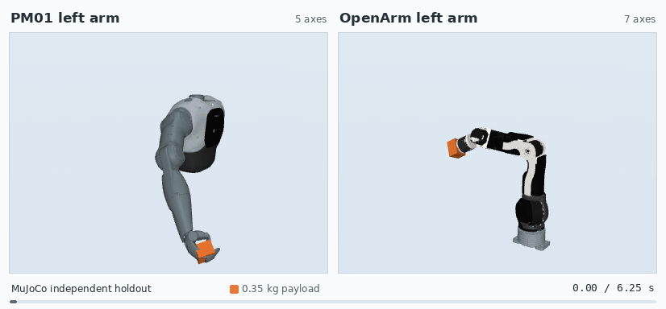

# RobotIdentification

[简体中文](README.md)

Robot dynamics parameter identification: named joint datasets, preprocessing, regression, diagnostics, physical validation, and immutable candidate artifacts. The C++17/Eigen core builds independently; Pinocchio and ROS 2 are optional adapters.

For the PM01 and OpenArm simulation quick start, see the [MuJoCo arm identification experiment](#mujoco-arm-identification-experiment).

| Package | Responsibility | Additional dependency |
|---|---|---|
| `robot_identification` | Arbitrary-DoF datasets, CSV, preprocessing, weighted/ridge/Huber solving, observability, and physical checks | Eigen |
| `robot_identification_pinocchio` | Fixed-base URDF rigid-body regressor | Pinocchio |
| `robot_identification_ros2` | Raw `JointState.position/effort` recording and session metadata | ROS 2 |
| `robot_identification_tools` | Streaming CSV inspection and candidate/review/rollback artifacts | Python standard library |

Recorders and model adapters depend on the identification core. The core builds independently of controllers and vendor SDKs.

For complete Pinocchio datasets, `backend.BuildProblem(dataset)` reuses call-local scratch. Individual samples and generic backend composition retain `Compute`; see the [Pinocchio backend](robot_identification_pinocchio/README.md).

Core 0.2.18 provides QR base parameters, a full-to-base mapping and constrained Fourier excitation design that compose with the Pinocchio backend. The [end-to-end example](robot_identification/examples/identification_design_example.cpp) covers design, fitting and independent validation; [algorithm and reference notes](docs/parameter-identification.md#参考项目评估与本次实现) describe equations, numerical assumptions and limits. Public interfaces remain compatible; the Pinocchio backend is 0.2.2.

The [actuator-network assessment](docs/parameter-identification.md#执行器动态网络方向) evaluates `sunzhon/actuator_net`; [semi-implicit hybrid identification](docs/parameter-identification.md#半隐式步进与物理学习混合辨识) adds an optional synthetic prototype and documents command/state histories, label units and independent trajectory validation.

Preprocessing preserves representable endpoint derivatives with subnormal secants; base-parameter reconstruction skips mixed zero dependencies; artifact creation rejects occupied outputs before scanning inputs.

Mass-matrix validation reads exact diagonal eigenvalues before normalization, retaining weak positive directions at extreme scales and creating the general decomposition workspace on demand.

CSV export batches numeric conversion and writes while preserving 17 significant digits, existing output bytes and the caller's rounding mode. The [export benchmark](benchmarks/README.md#csv-export-comparisons) reproduces timing and complete-data verification.

C++ CSV import selects a short-integer conversion path by row length while preserving numeric grammar, error locations and minimum sample counts. Processed imports retain complete final validation.

Streaming inspection proves short decimal rows without exponents finite from their text length, avoiding redundant per-value checks.

## Standalone build

The Ubuntu venv recipe requires `python3-venv`.

Requires CMake 3.15+, C++17, and Eigen 3.3.1+. Full validation also requires Python 3.10+ and `jsonschema==4.23.0`.

```bash
cmake -S robot_identification -B build/core -DBUILD_TESTING=ON \
  -DROBOT_IDENTIFICATION_BUILD_EXAMPLES=ON
cmake --build build/core --parallel 2
cmake -E chdir build/core ctest --output-on-failure
cmake --install build/core --prefix "$PWD/build/install"
./build/core/generic_regressor_example
./build/core/identification_design_example
python3 -m venv --system-site-packages .venv
source .venv/bin/activate
python3 -m pip install -r requirements-dev.txt
./scripts/test.sh
./scripts/run_identification_example.sh
```

Installed C++ consumers use `find_package(robot_identification REQUIRED)` and `robot_identification::robot_identification`.

With a native Pinocchio development environment, run `./scripts/test.sh build/with-pinocchio --with-pinocchio` to validate the optional backend and its installed consumers. Add dependency prefixes to `CMAKE_PREFIX_PATH` and shared-library directories to the loader path.

Reproduce synthetic solver and Pinocchio assembly measurements with the [standalone benchmarks](benchmarks/README.md).

## MuJoCo arm identification experiment

Run point design, MuJoCo data collection, dynamics identification, and independent trajectory replay for the fixed-base PM01 left arm (5 axes) and OpenArm left arm (7 axes). The launcher sets up Pinocchio 4.1.0 and MuJoCo 3.13.0 in an isolated environment.



The GIF shows the 6.25 s holdout recorded by the default demo. The orange box marks the simulated 0.35 kg payload.

On Ubuntu, install `build-essential`, `cmake`, `libeigen3-dev`, and `python3-venv`, and make sure `flock` is available. Run from the repository root. The launcher reads the URDFs from the sibling `../HumanoidAssets` directory by default. For an existing checkout elsewhere, pass `--assets-root /path/to/HumanoidAssets`. [Dependencies and asset setup](benchmarks/arm_identification/README.md#quick-start)

```bash
./scripts/run_arm_identification.sh --demo --output build/arms-demo
```

The demo generates a baseline training trajectory, an optimized training trajectory, and an independent holdout for each arm, with 401 points per trajectory. You can export the points first and use the saved plan for collection and fitting.

```bash
./scripts/run_arm_identification.sh --design-only --actuator-scale 1 --output build/arm-points
./scripts/run_arm_identification.sh --demo --reference-plan build/arm-points \
  --output build/arm-planned-demo
```

The demo writes `build/arms-demo/report.json` and stores each arm's points, raw samples, and URDF, MJCF, and MJB models under `pm01/` and `openarm/`. Use a new output directory for each run. Pass a saved capture to `--refit` to rerun identification. [Default results](benchmarks/arm_identification/README.md#default-demo-results) · [Output files](benchmarks/arm_identification/README.md#outputs) · [Refit a capture](benchmarks/arm_identification/README.md#refit-a-capture)

## Offline tools

```bash
python3 -m pip install ./robot_identification_tools
dataset_inspect session.csv --json
identification_artifact --help
```

See the [identification contract](docs/parameter-identification.md) and [tool reference](robot_identification_tools/README.md) for formats, review, and rollback semantics.

## Optional ROS 2 workspace

```bash
source /opt/ros/humble/setup.bash
rosdep install --from-paths . --ignore-src --rosdistro humble -y
./scripts/test_ros2.sh
source build/ros2/install/setup.bash
ros2 run robot_identification_ros2 joint_state_recorder --ros-args \
  -p input_topic:=/joint_states -p output_path:=/tmp/session-001.csv
```

The recorder consumes standard `sensor_msgs/JointState` messages. See the [recorder reference](robot_identification_ros2/README.md) for sample and file-recovery contracts.

Run `python3 utils/ros2_recording_smoke.py` to exercise the installed recorder with synthetic messages, checking joint order, dataset hashes, and shutdown cleanup.

## Using results

Identification produces candidate artifacts. Applying parameters requires a separate review, validation, and rollback process. Synthetic examples provide no hardware parameter sets or timing guarantees.

Licensed under the [MIT license](LICENSE).
