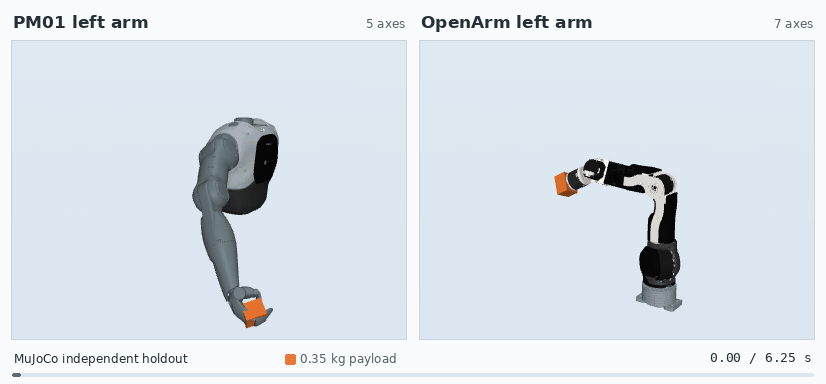

# MuJoCo arm identification

[简体中文快速入口](../../README.md#mujoco-手臂辨识实验)

This experiment uses the left arm of EngineAI PM01 (5 joints, fixed torso, fixed elbow end retained) and the left arm of OpenArm (7 joints, fixed base, detachable gripper omitted). The extracted URDFs preserve the joint frames, axes, limits, and moving-link inertias. The arms move in free space in MuJoCo.

## Quick start

Run the commands from the RobotIdentification repository root. On Ubuntu, install the native build tools, Eigen 3.4, Python with `venv`, and `flock`.

```bash
sudo apt-get update
sudo apt-get install build-essential cmake git libeigen3-dev python3-venv util-linux
```

The launcher creates an isolated environment with Pinocchio 4.1.0 and MuJoCo 3.13.0 and builds the C++ benchmark. Fresh launcher builds were verified with Python 3.10 and 3.12. [Pinned dependencies](requirements.txt)

Use a sibling `../HumanoidAssets` directory with the two URDFs below, or pass its location with `--assets-root /path/to/HumanoidAssets`. The runner generates its own mesh-free models from these files.

| Arm | Path relative to the asset root | Select one arm |
| --- | --- | --- |
| PM01 | `Engineai_PM01/urdf/robot.urdf` | `--robot pm01` |
| OpenArm | `OpenArm/left_arm.urdf` | `--robot openarm` |

For a new asset checkout, fetch the same revision and files used by CI. [HumanoidAssets revision](https://github.com/chase6305/HumanoidAssets/tree/067393d2b63b7ffa5b022e847ef2f4436799ad70) · [Arm identification workflow](../../.github/workflows/arm-identification-ci.yml)

```bash
git clone --filter=blob:none --no-checkout \
  https://github.com/chase6305/HumanoidAssets.git ../HumanoidAssets
git -C ../HumanoidAssets sparse-checkout set --no-cone \
  /Engineai_PM01/urdf/robot.urdf /OpenArm/left_arm.urdf
git -C ../HumanoidAssets checkout --detach 067393d2b63b7ffa5b022e847ef2f4436799ad70
```

Once the URDFs are in place, run the demo.

```bash
./scripts/run_arm_identification.sh --demo --output build/arms-demo
```

The demo generates bounded Fourier references, records encoder positions and applied torques, estimates joint velocities and accelerations from positions, then fits and exports the whole-arm and payload models. It prints a summary and the path to `report.json`. Each run needs a new output directory. Omit `--output` in `--demo` mode to use an automatically named directory.

The launcher reuses its environment and native build in `build/arm-identification/`. If setup fails, check `build/arm-identification/build.log`. To use a different Python interpreter for a fresh environment, set `PYTHON` and point `ARM_IDENTIFICATION_BUILD_DIR` at a new build directory.

## Default demo results



The animation renders the demo's recorded joint positions from `holdout_dense.csv` using the HumanoidAssets visual meshes. It shows each arm's 6.25 s independent holdout with a 0.35 kg box at the flange.

The torque RMSE is measured on an independent trajectory. The position RMSE is measured after reloading each whole-arm model and running 16 open-loop windows of 100 ms under recorded torques. The payload mass is fitted separately using the known arm and drive model. The simulated payload is 0.35 kg.

| Left arm | Base / full coordinates | Holdout torque RMSE [N·m] | Reloaded replay position RMSE [rad] | Fitted payload [kg] |
| --- | ---: | ---: | ---: | ---: |
| PM01 | 39 / 60 | 0.00374 | 0.000114 | 0.351104 |
| OpenArm | 55 / 84 | 0.00243 | 0.000350 | 0.350616 |

All 1,024 separately sampled workspace states per arm were within the effort limits. The identified models had positive mass matrices at all of those states and reached workspace torque RMSE of 0.01129 N·m for PM01 and 0.01549 N·m for OpenArm. Recollecting the same reference plan in MuJoCo 4.0.1 changed the whole-arm holdout RMSE by less than `1e-9 N·m` for each arm.

## Generate and reuse point plans

Each arm has two 8 s training trajectories (baseline and optimized) and a separate 6.25 s holdout, with 401 points per trajectory by default. The reference CSVs contain time, joint positions, velocities, and accelerations. MuJoCo evaluates the Fourier reference on its own integration grid when tracking these points, so actual measured states are saved separately.

```bash
./scripts/run_arm_identification.sh --design-only --actuator-scale 1 --output build/arm-points
./scripts/run_arm_identification.sh --demo --reference-plan build/arm-points \
  --output build/arm-planned-demo
```

The plan's `--actuator-scale 1` matches the demo's drive regressor. Set `--sample-count`, `--training-period-s`, and `--holdout-period-s` when generating the plan to change the point count or cycle durations. Faster cycles can cause the designer to reduce the initial motion amplitude to stay within the velocity, acceleration, and jerk bounds.

When you reuse a plan, the runner verifies the asset hash, joint order, timestamps, and Fourier states. It uses the saved point count, periods, and regressor structure. You can use `--robot pm01` or `--robot openarm` on both commands to work with only one URDF.

## Refit a capture

Refit uses the saved arm models and recorded CSVs. The acquisition settings, Huber threshold, and model export choices carry over unless you override them. The refit publishes its output when the selected arms and their report are ready. If fitting fails before publication, you can retry with the same output path.

```bash
./scripts/run_arm_identification.sh --refit build/arms-demo --summary --output build/arms-demo-refit
```

The `arm-identification-demo` artifact from a successful CI run includes the URDFs and CSV inputs required to refit both arms. Extract it so `report.json`, `pm01/`, and `openarm/` are directly inside `build/arms-from-ci/`, then run the command below. [Arm identification workflow runs](https://github.com/chase6305/RobotIdentification/actions/workflows/arm-identification-ci.yml)

```bash
./scripts/run_arm_identification.sh --refit build/arms-from-ci --summary --output build/arms-ci-refit
```

To compare preprocessing settings on the same capture, select an estimator in the refit command.

```bash
./scripts/run_arm_identification.sh --refit build/arms-demo --raw-estimator local-cubic \
  --raw-window 17 --huber-auto --output build/arms-local-cubic
```

## Outputs

| Path in the demo output | Contents |
| --- | --- |
| `report.json` | Source URDF hashes, joint order, dependency versions, trajectory scores, ranks, fitted parameters, and validation metrics. |
| `<arm>/{baseline,optimized,holdout}_states.csv` | Planned time, position, velocity, and acceleration, with a zero torque field. |
| `<arm>/train_{baseline,optimized}_raw.csv` | Recorded timestamps, noisy encoder positions, and applied torques with simulated sensor noise. |
| `<arm>/train_{baseline,optimized}.csv` | Training samples used by the fit, including estimated velocities and accelerations. |
| `<arm>/holdout.csv`, `<arm>/holdout_dense.csv` | Independent validation samples and the integration-rate replay trace. |
| `<arm>/holdout_predicted_physical_arm.csv` | Predicted torque from the physically constrained fit on the saved holdout states. |
| `<arm>/nominal.urdf`, `<arm>/truth.{urdf,mjb}` | Extracted unloaded model and the simulated test plant. The MJB contains the simulated drive parameters. |
| `<arm>/identified_{arm,payload}.{urdf,xml,mjb}` | Fitted arm and known-arm payload models. Use MJCF (`.xml`) to carry the fitted drive coefficients across MuJoCo versions. |

`<arm>` is `pm01` or `openarm`. In the JSON report, `robots.<arm>.fit.physical_arm_fit` contains the whole-arm metrics, `reloaded_mujoco_replay` records position error after reloading, and `robots.<arm>.fit.payload_fit` contains the separate payload estimate.

## Acquisition and preprocessing options

Use a forward rollout to fit from the simulated derivative states. `--acquisition inverse` selects prescribed-state inverse dynamics. For a clean torque control, set `--torque-noise-nm 0 --outlier-nm 0`.

```bash
./scripts/run_arm_identification.sh --acquisition rollout --output build/arm-rollout
```

Run the forward simulation and fit using the recorder-format position and torque measurements.

```bash
./scripts/run_arm_identification.sh --acquisition rollout --fit-input raw \
  --raw-estimator local-cubic --raw-window 9 --timestamp-jitter-ms 2 --output build/arm-raw
```

The local cubic estimator fits position against centered, scaled timestamps in each window and evaluates its first and second derivatives at the center. A nine-point window discards four points at either end and preserves each retained timestamp and torque. `--raw-estimator moving-average` selects the core's centered smoothing and finite differences. The independent holdout uses clean simulated derivatives in both cases.

`--raw-estimator periodic-fourier --raw-harmonics 7` fits the measured joint positions over one full capture period, then evaluates the derivatives analytically at the actual timestamps. It retains all position and torque samples and uses the first and last timestamps to determine the period. Use this estimator with steady periodic captures.

`--raw-estimator periodic-fourier-huber` applies Huber weighting to each joint's encoder residuals before analytic differentiation. The report records each joint's threshold in radians. To test encoder spikes, set `--encoder-outlier-rad` to the impulse amplitude. Each training position has a 1% chance of an independently signed impulse, with the realization paired across the two training trajectories.

`--timestamp-jitter-ms` shifts the capture times within the requested bound on the MuJoCo integration grid. The CSV records the actual times. The two training trajectories share the same sample offsets, and the holdout uses an independent seed.

The demo uses `--timestamp-jitter-ms auto`, which requests up to 2 ms and reduces that bound for shorter intervals. The report records the resulting bound and the actual jitter on the integration grid. An explicit numeric value keeps the requested bound fixed.

`--capture-dropout` sets the probability of losing each interior training sample, preserving the period endpoints. `--encoder-resolution-rad` rounds the raw positions to encoder increments. The training trajectories share the seeded dropout mask. These controls keep positions and torques synchronized at every retained timestamp.

## Torque-channel latency

To test alignment against a known torque latency, simulate the delay in the training channel and refit the same recorded data.

```bash
./scripts/run_arm_identification.sh --demo --torque-delay-ms 8 --output build/arms-delayed
./scripts/run_arm_identification.sh --refit build/arms-delayed --align-torque-ms 8 \
  --output build/arms-delay-aligned
```

A positive delay means that torque recorded at time `t` describes the arm at `t - d`. The Fourier estimator evaluates position and derivatives at `t - d`, keeping the original recorded time and torque value in the processed CSV. The alignment uses the periodic extension at the endpoints. The captured holdout stays synchronized and is shared across both fits.

Use `--search-torque-delay-ms 20` to search up to 20 ms in either direction. The search transfers each model between the two training trajectories and accepts a shift when the mean cross-trajectory Huber loss improves by at least 2% compared with zero delay. It fits the encoder harmonics once on up to 801 points per trajectory, searches at most 17 shifts, then refits on all available samples. The per-arm `torque_alignment` report includes the tested range, loss, and applied delay. A refit inherits that delay unless an alignment option is supplied.

## Drive dynamics, whole-arm fit, and payload

For a new acquisition, add `--actuator-scale 1` to test synthetic reflected rotor inertia and linear viscous friction. The plant uses per-joint armature `0.04 r kg·m²` and damping `(0.02 + 0.05 r) N·m·s/rad`, where `r` is each joint's URDF effort limit divided by the largest effort limit on that arm. The scale multiplies both terms. In this mode, `truth.mjb` contains the compiled MuJoCo plant. The fit adds columns for each joint's acceleration and velocity, and the report compares against a rigid-only model fitted to the same samples. The base-parameter rank determines which combinations can be identified. See the [MuJoCo joint model reference](https://mujoco.readthedocs.io/en/stable/XMLreference.html#body-joint).

The actuator report recovers individually observable coefficients by solving for each full coordinate as a linear combination of base coordinates. All viscous coefficients are observable on both arms, and the first two rotor inertias appear as `null` individual estimates. The projected candidate uses the final Huber weighted least-squares metric to make the observable passive coefficients nonnegative within numerical tolerance. Its holdout and mass-matrix metrics are reported alongside the unconstrained fit.

The following command collects raw encoder measurements and runs forward replay with drive dynamics.

```bash
./scripts/run_arm_identification.sh --acquisition rollout --actuator-scale 1 --replay \
  --fit-input raw --raw-estimator periodic-fourier --timestamp-jitter-ms 2 \
  --output build/arm-drive-replay
```

Add `--estimate-payload` when the arm and drive dynamics are known. The solver subtracts that prior model's torque and identifies the 10 inertial coefficients of the terminal payload. It preserves the fitted mass and center of mass while projecting the centered second-moment matrix onto positive eigenvalues when needed. The resulting `identified_payload.urdf` and `identified_payload.mjb` can be loaded again, and the runner checks the binary model's holdout torque against the native regression prediction.

By default the box sits with one face on the URDF mounting plane. For PM01 the mounting frame is `J_FIXED_ELBOW_END_L`, and the box extends along local −Z. For OpenArm it is `LEFT_HAND_CONNECTOR`, and the box extends along local +Z. The center is half the box depth beyond the mounting plane. The default centers in the last moving link's frame are `[0.03, -0.02, -0.16]` m for PM01 and `[0, 0, 0.1201]` m for OpenArm.

Use `--payload-kg` and `--payload-size-m X Y Z` to change the box. To place its center explicitly in the last moving link's frame, use `--payload-center-m X Y Z`. For a mounted box, the report records each arm's resolved `payload_center_xyz_m` and, for the default mount, `payload_flange_joint`. Refitting a capture uses the saved truth URDF and recorded data.

Add `--estimate-arm` to fit the moving links and drive coefficients together. The solver takes the optimized trajectory and final Huber weights, then fits link pseudo-inertia matrices constrained to be at least 2% of their nominal matrices. Rotor inertia and viscous damping are nonnegative. The prior weight in normalized coordinates is the squared robust torque residual scale divided by the observation count, limited to `[1e-11, 1e-6]`. The nominal URDF helps select a full parameter vector among dynamically equivalent models. Each reported moving-link inertia includes any welded descendants, and the terminal payload can be absorbed into the last moving link. See [Wensing, Kim and Slotine on physically consistent inertial identification](https://arxiv.org/abs/1701.04395).

`identified_arm.urdf` preserves the joint kinematics and contains the estimated link inertias. `identified_arm.mjb` and `identified_arm.xml` also contain the estimated drive coefficients when they are fitted. The portable MJCF text and version-specific MuJoCo binary agree to `1e-10 N·m` on every holdout torque. The payload export provides the same three formats. See [MuJoCo model encoding](https://mujoco.readthedocs.io/en/3.13.0/programming/modeledit.html#model-encoding-saving).

The runner compares the reloaded binary's predicted holdout torque against `holdout_predicted_physical_arm.csv` to within `1e-7 N·m` and, with `--replay`, steps it under the recorded holdout torques. `physical_arm_fit` in the report contains the full coordinates, solver convergence, holdout errors, and replay results. The demo summary shows this model's metrics.

The reloaded arm also predicts torque on 1,024 independent workspace states within the middle 85% of each padded joint interval, with speeds up to 75% of the design caps and accelerations up to 18 rad/s². `workspace_validation` reports the count within the simulated effort limits, the smallest fitted mass-matrix eigenvalue, and the nominal and identified torque errors. These samples are generated independently of the fitted trajectories.

## Use an existing native build

An existing core and Pinocchio installation can also build the benchmark with `cmake -S benchmarks/arm_identification -B build/arm-bench` and `cmake --build build/arm-bench --parallel 2`. In that case, run `run_experiment.py` with `--executable build/arm-bench/arm_identification` and a Python environment containing MuJoCo and NumPy. See the [standalone installation guide](../../README_EN.md#standalone-build).

## Protocol

Before column normalization, the benchmark zeros calibration columns below 64 machine epsilons times the largest calibration entry. It checks the same columns against this bound in subsequent regressors. This removes two numerical directions in the PM01 root inertia and keeps the reported rank stable across simulator versions.

1. The Pinocchio rigid-body regressor builds the base-parameter basis from 192 deterministic calibration states. These states are used only to learn linear dependencies in the regressor. The existing Fourier optimizer improves the mean log information score in that fixed basis under position, velocity, acceleration, and jerk limits. The position interval has a 5% margin at each end and the speed cap is the smaller of 80% of the URDF limit and 4 rad/s. The acceleration and jerk caps are 25 rad/s² and 160 rad/s³.
2. The benchmark automatically generates 401 joint references for each 8 s training trajectory and an independent 401-point holdout over 6.25 s. The Fourier coefficients let the rollout evaluate the same continuous reference at every integration step. With `--acquisition rollout`, a computed-torque controller based on the unloaded model tracks the reference while the loaded MuJoCo plant integrates with steps of at most 1 ms. It tracks the periodic reference for 3 s before recording, limits applied torque to each joint's URDF effort, and records position, velocity, acceleration, and applied torque at the same instant. The acceleration feedback gains are 10,000 s⁻² for position error and 200 s⁻¹ for velocity error. The plant and replay both use semi-implicit Euler with the viscous force evaluated explicitly. With `--acquisition inverse`, MuJoCo evaluates the torque at each analytical reference state and rejects torques above the URDF effort. Both modes reject active constraints and use gravity `(0, 0, -9.81) m/s²`. See the [MuJoCo stepping and inverse-dynamics documentation](https://mujoco.readthedocs.io/en/stable/programming/simulation.html).
3. The truth model includes a fixed 0.35 kg box mounted at the flange. For the default noisy experiment, each training torque gets Gaussian noise with 0.02 N·m standard deviation and a 1% chance of an additional signed 0.75 N·m impulse. The baseline and optimized trajectories share the same noise realization by sample index and joint. Holdout labels remain clean. OLS and Huber (threshold 0.06 N·m) fit the loaded-arm inertial combinations using the nominal arm's kinematics. The known payload is used to construct the simulator and the oracle check, and never enters the fitted regression problem.
4. The fit solves `tau = Y_base(q, dq, ddq) beta`, where `beta = full_to_base * theta` and `theta` stacks the Pinocchio rigid-body coordinates. The oracle limits the maximum MuJoCo versus full Pinocchio torque error to `1e-7 N·m`, allowing for the URDF importer's conversion of full inertia tensors to principal axes. It independently limits the change introduced by reducing the Pinocchio regressor to `1e-8 N·m`. The reported coordinates describe observable combinations that include the payload. Individual masses, centers of mass, and inertia tensors cannot be recovered uniquely from these data.

`report.json` records source URDF hashes, tool versions, joint order, design scores, ranks, condition numbers, effort fractions, and holdout errors in N·m. It also includes the zero-based selected regressor columns, normalization scales, full-to-base mapping, and fitted and oracle base coordinates. Full coordinates repeat the Pinocchio order `mass, mcx, mcy, mcz, Ixx, Ixy, Iyy, Ixz, Iyz, Izz` for each joint, with inertia about the corresponding joint-frame origin. The per-arm directories contain temporary models and CSVs matching the core contracts. The `*_states.csv` files contain the automatic references with placeholder zero torque. The `*_raw.csv` files contain timestamps, joint positions, and torque. The processed `train_baseline.csv`, `train_optimized.csv`, and `holdout.csv` files also contain velocity and acceleration. Raw training positions include paired encoder noise with a default standard deviation of `5e-5 rad`.

`--huber-auto` sets each training trajectory's threshold to `1.345 × 1.4826 × MAD` of its OLS torque residuals, with a numerical floor for clean inputs. The fitted thresholds appear in the report.

The forward check reconstructs the joint-space mass matrix from the acceleration-linear part of the regressor and checks its symmetry and smallest eigenvalue at up to 81 calibration poses and 81 holdout poses. It predicts acceleration by solving `M(q) ddq = tau - bias(q, dq)` at the holdout poses. The acceleration RMSE is `null` when any tested holdout mass matrix fails validation. `holdout_predicted_optimized_huber.csv` contains the optimized Huber torque predictions on the exact states recorded in `holdout.csv`.

With `--replay`, `holdout_dense.csv` records the states and torques at every integration step. The nominal and fitted models each start at the recorded state of 16 independent 100 ms windows and integrate under the same applied torques. The report counts completed windows and gives position errors when all windows complete.

The simulator evaluates long references in blocks and interpolates delayed torque from adjacent integration ticks. For a 160 s OpenArm capture with 401 recorded points and an 8.3 ms delay, the collection process used about 64 MiB peak RSS, down from about 110 MiB when it held the full reference and torque history. The recorded arrays matched exactly in that comparison.

Saving the pre-step state directly into the recorder's arrays made dense eight-second captures about 13% faster across both arms in five paired runs. Recorded samples, dense traces, and capture diagnostics matched exactly.

For paired preprocessing comparisons on an existing `--fit-input simulator` run, replay the same raw samples through each window.

```bash
benchmark_dir=build/arm-identification
"$benchmark_dir/venv/bin/python" benchmarks/arm_identification/compare_raw.py \
  --executable "$benchmark_dir/benchmark/arm_identification" \
  --output build/arm-window-comparison.csv build/arm-rollout
```

## Reference results

Prescribed-state inverse dynamics holdout torque RMSE in N·m, with fitted results reported as medians over the CI noise seeds `20261124, 11, 29, 47, 71`.

| Left arm | Base / full coordinates | Unloaded nominal | Baseline OLS | Baseline Huber | Optimized OLS | Optimized Huber |
| --- | ---: | ---: | ---: | ---: | ---: | ---: |
| PM01 | 31 / 50 | 0.52037 | 0.04355 | 0.01103 | 0.01234 | 0.00431 |
| OpenArm | 43 / 70 | 0.43266 | 0.03789 | 0.01160 | 0.01109 | 0.00337 |

In the clean control, the relative error against the known base coordinates is about `1.38e-9` for PM01 and `6.42e-9` for OpenArm. These figures characterize rigid-body inverse dynamics along prescribed trajectories in simulation.

At torque noise `0.20 N·m` and encoder noise `0.0008 rad`, the OpenArm median holdout torque RMSE over six seeds was `0.05153 N·m` for optimized Huber and `0.02148 N·m` for the constrained model. The reloaded constrained model finished all 16 replay windows on each seed.
