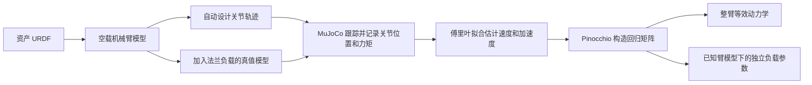

# PM01 和 OpenArm 单臂动力学建模

本文以 `main` 上合入 PR #7 的实现和默认 `--demo` 为准。两条左臂各自作为固定基座的串联刚体系统建模。关节坐标系、转轴和限位来自资产 URDF，MuJoCo 负责生成状态和关节力矩，Pinocchio 负责建立动力学回归。 [PR #7](https://github.com/chase6305/RobotIdentification/pull/7) · [对应实现](https://github.com/chase6305/RobotIdentification/tree/1fb32f3232b23c5ec0e4df7ca102a45330ba5eb4/benchmarks/arm_identification)



## 机械臂和法兰负载

`nominal.urdf` 从原始 URDF 裁出左臂，保留连杆惯量和关节运动学，省略视觉和碰撞网格。PM01 固定在躯干链节 `LINK_TORSO_YAW`，并保留固定肘端件的惯量。OpenArm 固定在 `left_arm_base`，采集模型省略可拆夹爪，法兰坐标系取自源 URDF 的手部连接器。 [模型提取代码](https://github.com/chase6305/RobotIdentification/blob/1fb32f3232b23c5ec0e4df7ca102a45330ba5eb4/benchmarks/arm_identification/arm_models.py#L54-L100)

`truth.urdf` 在空载模型上加一块默认 **0.35 kg、60 × 50 × 40 mm** 的均匀长方体。长方体的一个面贴着法兰，质心沿法兰局部 Z 轴向外偏置半个盒深，即 20 mm。

设末个活动连杆系为 $L$，法兰系为 $F$。$p_F^L$ 和 $R_{LF}$ 分别是法兰原点在 $L$ 中的位置以及从 $F$ 转到 $L$ 的旋转，取自源 URDF 固定关节。盒体深度为 $d$，外伸方向符号为 $s$，$e_z$ 为法兰 Z 轴单位向量。负载质心 $C$ 的位置和绕质心的惯量写成

$$
p_C^L = p_F^L + R_{LF} e_z\,s\frac{d}{2},
\qquad I_C^L = R_{LF} I_C^F R_{LF}^{\top}.
$$

生成的 URDF 用一个固定关节把负载原点放在 $p_C^L$，并以连杆坐标轴表达 $I_C^L$。显式指定 `--payload-center-m X Y Z` 时，参数直接表示末个活动连杆系中的质心坐标。 [法兰变换与惯量代码](https://github.com/chase6305/RobotIdentification/blob/1fb32f3232b23c5ec0e4df7ca102a45330ba5eb4/benchmarks/arm_identification/arm_models.py#L103-L152) · [负载参数说明](../benchmarks/arm_identification/README.md#drive-dynamics-whole-arm-fit-and-payload)

| 左臂 | 自由度 | 源 URDF 法兰 | 盒体延伸方向 | 负载质心在末个活动连杆坐标系中的位置 |
| --- | ---: | --- | --- | --- |
| PM01 | 5 | `J_FIXED_ELBOW_END_L` | 法兰局部 −Z | `[0.03, -0.02, -0.16]` m |
| OpenArm | 7 | `LEFT_HAND_CONNECTOR` | 法兰局部 +Z | `[0, 0, 0.1201]` m |

驱动参数由仿真配置注入。默认 Demo 按每个关节的 URDF 力矩上限比例合成折算转子惯量和线性黏性阻尼，并随仿真模型写入 `truth.mjb`。 [驱动配置与真值模型](https://github.com/chase6305/RobotIdentification/blob/1fb32f3232b23c5ec0e4df7ca102a45330ba5eb4/benchmarks/arm_identification/run_experiment.py#L251-L326)

## 动力学方程与自动采点

默认 Demo 的关节力矩模型为

$$
\tau = Y_{\mathrm{rb}}(q,\dot q,\ddot q)\pi + J_r \odot \ddot q + b \odot \dot q.
$$

`Y_rb` 是 Pinocchio 构造的刚体力矩回归矩阵，包含惯性、科氏与离心力和重力的贡献。参数向量 `π` 为每个活动关节堆叠 10 项，即质量、3 个一阶质量矩和 6 个关于关节坐标原点的惯量分量。`J_r` 和 `b` 分别表示每轴的折算转子惯量和线性黏性阻尼，`⊙` 表示逐元素乘法。 [Pinocchio 回归实现](https://github.com/chase6305/RobotIdentification/blob/1fb32f3232b23c5ec0e4df7ca102a45330ba5eb4/robot_identification_pinocchio/src/pinocchio_regressor.cpp#L60-L80) · [驱动力矩回归代码](https://github.com/chase6305/RobotIdentification/blob/1fb32f3232b23c5ec0e4df7ca102a45330ba5eb4/robot_identification/src/identification.cpp#L91-L116)

1. **生成参考点。** 每条臂自动生成两条 8 秒训练轨迹和一条 6.25 秒独立验证轨迹，每条 401 点。优化器调整关节空间的周期傅里叶系数，提高可辨识参数的信息量，并限制关节位置及其一到三阶时间导数。默认报告中，训练轨迹优化使基参数回归矩阵的条件数从 539 降到 54（PM01），从 774 降到 129（OpenArm）。 [点位生成代码](https://github.com/chase6305/RobotIdentification/blob/1fb32f3232b23c5ec0e4df7ca102a45330ba5eb4/benchmarks/arm_identification/fit_arm.cpp#L217-L277)
2. **采集实际仿真状态。** 空载模型上的计算力矩控制器跟踪连续参考，力矩按 URDF 上限裁剪后施加给带载 MuJoCo 模型。原始训练 CSV 保存时间、带噪关节位置和力矩。默认用周期傅里叶拟合对位置求导，得到用于辨识的速度与加速度。 [采集与训练数据处理](https://github.com/chase6305/RobotIdentification/blob/1fb32f3232b23c5ec0e4df7ca102a45330ba5eb4/benchmarks/arm_identification/run_experiment.py#L303-L375)

## 两条辨识路径

| 输出 | 已知量或先验 | 拟合量 |
| --- | --- | --- |
| `identified_arm` | URDF 关节几何作为已知量，空载连杆惯量作为先验 | 带载整臂的连杆等效惯量和每轴驱动系数 |
| `identified_payload` | URDF 关节几何、空载连杆惯量和驱动系数作为已知量 | 末端负载的质量、质心和惯量 |

整臂流程先用带列主元的 QR 分解找出基参数，再用优化轨迹的 Huber 权重、名义惯量先验和物理约束求一组完整参数。PM01 的参数维数是 60，基参数秩是 39。OpenArm 的参数维数是 84，基参数秩是 55。秩亏使多组逐连杆参数可给出相同的关节力矩。导出时，焊接件和法兰负载的惯性贡献可写入活动连杆的等效惯量。 [基参数求解](https://github.com/chase6305/RobotIdentification/blob/1fb32f3232b23c5ec0e4df7ca102a45330ba5eb4/robot_identification/src/base_parameters.cpp#L36-L71) · [整臂物理约束求解](https://github.com/chase6305/RobotIdentification/blob/1fb32f3232b23c5ec0e4df7ca102a45330ba5eb4/benchmarks/arm_identification/physical_arm_fit.cpp#L157-L220)

独立负载流程从测得力矩中扣除已知空载臂和驱动的贡献，再用末端的 10 列回归量拟合负载。默认仿真已知空载 URDF 的连杆惯量和采集时配置的驱动系数。空载模型的力矩误差也会进入这个残差，因此负载参数的可信度依赖空载模型精度。 [拟合量与已知量配置](https://github.com/chase6305/RobotIdentification/blob/1fb32f3232b23c5ec0e4df7ca102a45330ba5eb4/benchmarks/arm_identification/fit_arm.cpp#L405-L443) · [独立负载求解](https://github.com/chase6305/RobotIdentification/blob/1fb32f3232b23c5ec0e4df7ca102a45330ba5eb4/benchmarks/arm_identification/payload_fit.cpp#L11-L67)

两种拟合都能导出 URDF、MJCF（`.xml`）和 MuJoCo 二进制（`.mjb`）。MJCF 和 MJB 也保存驱动系数。`--refit` 直接使用原采集包中的 `nominal.urdf`、`truth.urdf` 和记录的 CSV，适合在同一批数据上比较预处理或拟合配置。 [模型导出与复跑说明](https://github.com/chase6305/RobotIdentification/blob/1fb32f3232b23c5ec0e4df7ca102a45330ba5eb4/benchmarks/arm_identification/README.md#refit-a-capture)

## 默认 Demo 的验证结果

| 指标 | PM01 | OpenArm |
| --- | ---: | ---: |
| 整臂独立轨迹力矩 RMSE | 0.00374 N·m | 0.00243 N·m |
| 导出模型开环回放的位置 RMSE | 0.000114 rad | 0.000350 rad |
| 完成的 100 ms 回放窗口 | 16 / 16 | 16 / 16 |
| 独立负载质量估计，真值 0.350 kg | 0.351104 kg | 0.350616 kg |
| 负载质心距离误差 | 0.82 mm | 0.74 mm |
| 负载质心惯量张量相对误差 | 119% | 313% |

惯量相对误差按 $\lVert I_{\mathrm{est}}-I_{\mathrm{truth}}\rVert_F/\lVert I_{\mathrm{truth}}\rVert_F$ 计算，两个张量都绕负载质心、以末个活动连杆的坐标轴表达。默认盒体的质心惯量 Frobenius 范数约为 $2.63\times 10^{-4}$ kg·m²，比换算到末端坐标原点时的平行轴项小一个数量级以上。这个尺度差有助于解释为何力矩和负载质心误差较小，质心惯量的相对误差仍然较大。这里验证的是固定基座、无接触仿真下的整臂力矩和短时运动预测。 [误差计算代码](https://github.com/chase6305/RobotIdentification/blob/1fb32f3232b23c5ec0e4df7ca102a45330ba5eb4/benchmarks/arm_identification/arm_models.py#L226-L248) · [默认 Demo 结果](../benchmarks/arm_identification/README.md#default-demo-results)

## 复现与核对

准备好两条臂的源 URDF 后，在仓库根目录运行默认 Demo。脚本会生成点位、采集数据、拟合并导出两臂模型。 [资产与依赖准备](../benchmarks/arm_identification/README.md#quick-start)

```bash
./scripts/run_arm_identification.sh --demo --output build/arms-modeling
```

也可以用已记录的采集直接重跑。将下载包解压到 `build/arms-from-ci/`，使 `report.json`、`pm01/` 和 `openarm/` 直接位于该目录下。 [已验证采集包](https://github.com/chase6305/RobotIdentification/actions/runs/45548604109/artifacts/14992982273) · [CI 运行列表](https://github.com/chase6305/RobotIdentification/actions/workflows/arm-identification-ci.yml)

```bash
./scripts/run_arm_identification.sh --refit build/arms-from-ci \
  --summary --output build/arms-modeling-refit
```

在相应输出目录的 `report.json` 中，用 `robots.<arm>.fit.physical_arm_fit` 查看整臂独立轨迹误差和模型重载回放，用 `robots.<arm>.fit.payload_fit.reference_errors` 查看负载质量、质心和惯量误差。 [输出文件说明](../benchmarks/arm_identification/README.md#outputs)

### 负载惯量对力矩噪声和求导的敏感度

复用上节 Demo 的点位计划，固定随机种子 `20261124`、法兰负载和驱动参数。各组的真值 URDF 和独立验证轨迹数据逐字节一致。下表只改变训练用的导数来源和噪声设置。默认扭矩噪声是标准差 0.02 N·m 的高斯噪声及 1% 概率的 ±0.75 N·m 脉冲，默认位置噪声标准差为 0.00005 rad。 [训练数据生成代码](https://github.com/chase6305/RobotIdentification/blob/1fb32f3232b23c5ec0e4df7ca102a45330ba5eb4/benchmarks/arm_identification/run_experiment.py#L328-L375)

| 训练用速度和加速度 | 力矩噪声 | 拟合用位置噪声 | PM01 惯量相对误差 | OpenArm 惯量相对误差 |
| --- | --- | --- | ---: | ---: |
| 仿真真值 | 关闭 | 关闭 | <0.001% | <0.001% |
| 仿真真值 | 默认 | 关闭 | 133% | 300% |
| 7 阶傅里叶求导 | 关闭 | 关闭 | 107% | 72% |
| 7 阶傅里叶求导 | 关闭 | 默认 | 108% | 72% |
| 7 阶傅里叶求导 | 默认 | 关闭 | 120% | 313% |
| 7 阶傅里叶求导 | 默认 | 默认 | 119% | 313% |

这组轨迹上，默认力矩噪声和 7 阶傅里叶求导各自都能引入明显的惯量误差，默认位置噪声的影响较小。用同一份无噪声 CSV 重拟合，14 阶将两臂误差降到 **32% 和 8.8%**。用默认噪声的 CSV 重拟合，14 阶的惯量误差为 **107% 和 298%**，OpenArm 负载模型的验证力矩 RMSE 从 0.001690 变为 0.001704 N·m。阶数对照适用于这份采集的轨迹和噪声配置。

用上节生成的 `build/arms-modeling` 复现无噪声对照和调阶。第一条命令直接使用 MuJoCo 记录的导数，第二条命令从同一条无噪声轨迹的编码器位置估计导数。最后一条命令对无噪声采集改用 14 阶傅里叶求导。

```bash
common=(--reference-plan build/arms-modeling --acquisition rollout --actuator-scale 1
  --replay --timestamp-jitter-ms auto --estimate-payload
  --torque-noise-nm 0 --outlier-nm 0 --encoder-noise-rad 0)
./scripts/run_arm_identification.sh "${common[@]}" --fit-input simulator \
  --output build/arms-clean-simulator
./scripts/run_arm_identification.sh "${common[@]}" --fit-input raw \
  --raw-estimator periodic-fourier --output build/arms-clean-fourier
./scripts/run_arm_identification.sh --refit build/arms-clean-fourier \
  --no-estimate-arm --raw-harmonics 14 --output build/arms-clean-fourier-14
```

### 跨种子对照与较短训练轨迹

用默认噪声、401 个参考点和种子 `11、29、47、71` 比较 8 秒和 5.5 秒两套训练计划。每对 7 阶与 14 阶拟合都使用同一份记录的 CSV，同一个种子下的两套计划使用逐字节相同的独立验证 CSV。表内是四个种子的中位数，括号内是 14 阶误差更低的次数。

| 训练周期 | 左臂 | 负载惯量相对误差，7 阶 → 14 阶 | 负载模型验证力矩 RMSE，7 阶 → 14 阶 |
| --- | --- | ---: | ---: |
| 8 秒 | PM01 | 166% → 114%（3/4） | 0.001803 → 0.001260 N·m（3/4） |
| 8 秒 | OpenArm | 299% → 289%（3/4） | 0.001485 → 0.001346 N·m（3/4） |
| 5.5 秒 | PM01 | 93% → 77%（3/4） | 0.001738 → 0.000982 N·m（4/4） |
| 5.5 秒 | OpenArm | 180% → 122%（3/4） | 0.001050 → 0.000832 N·m（3/4） |

固定 14 阶时，5.5 秒计划在每个配对种子上都降低了两臂的惯量误差。PM01 的八组阶数对照里有三组出现惯量误差与力矩 RMSE 变化方向不同。选配置时应按目标读取对应的指标。这里的比较基于两套仿真轨迹、固定法兰负载和已知驱动。

用默认种子单独跑完整 Demo 时，5.5 秒和 14 阶组合将 PM01 的负载惯量误差从 119% 降到 65%，OpenArm 从 313% 降到 121%。整臂验证力矩 RMSE 分别从 0.00374 降到 0.00348 N·m、从 0.00243 降到 0.00191 N·m，两臂各完成 16 个回放窗口。

```bash
./scripts/run_arm_identification.sh --demo --training-period-s 5.5 \
  --raw-harmonics 14 --output build/arms-5p5-14
```

复现表格时，用 `--demo` 分别指定 `--training-period-s 8` 或 `--training-period-s 5.5`，同时传入 `--raw-harmonics 7` 和表中的各个 `--seed`。再用 `--refit`、`--no-estimate-arm` 和 `--raw-harmonics 14` 重拟合各自的记录。负载模型的力矩 RMSE 位于 `robots.<arm>.fit.payload_fit.physical_candidate.holdout_rmse_nm`。

### 增加采样点与合并训练的对照

先对上节的 16 个拟合配置及两个默认种子 Demo 做训练合并对照。把基线和优化轨迹都用于独立负载拟合后，PM01 的验证力矩 RMSE 在 18 个配置中全部降低，惯量误差中位数从 91% 降到 80%。OpenArm 的验证力矩 RMSE 在 18 个配置中有 6 个降低，惯量误差中位数从 189% 变为 193%。

单独检验采样密度时，保持 5.5 秒训练计划、14 阶求导和默认噪声幅度，并关闭时间戳抖动。每个种子先采集 801 点，再从同一份训练 CSV 每隔一行取样形成 401 点。两个拟合共用同一份 401 点独立验证 CSV。结果为四个种子的中位数，括号内是 801 点误差更低的次数。

| 左臂 | 负载惯量相对误差，401 → 801 点 | 负载模型验证力矩 RMSE，401 → 801 点 |
| --- | ---: | ---: |
| PM01 | 77% → 38%（3/4） | 0.001502 → 0.000704 N·m（4/4） |
| OpenArm | 115% → 83%（2/4） | 0.000672 → 0.000586 N·m（2/4） |

这组仿真中，两臂的中位误差都降低。OpenArm 的改善随种子变化，选定采样密度后仍需核查独立验证指标。下面的命令运行 801 点配置并导出、回放两条臂。

```bash
./scripts/run_arm_identification.sh --demo --training-period-s 5.5 \
  --raw-harmonics 14 --sample-count 801 --timestamp-jitter-ms 0 \
  --output build/arms-5p5-14-801
```
